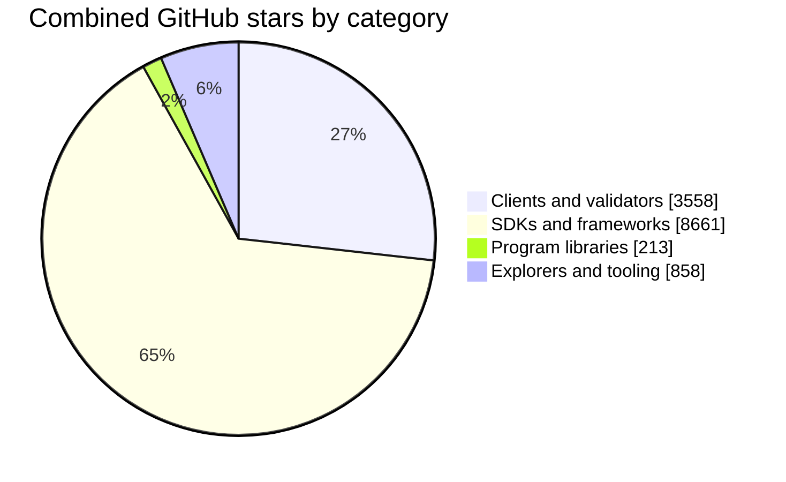

# Awesome Craft Solana 

> A curated list of verified open-source Solana clients, SDKs, frameworks, explorers and program libraries.

Running validators or deploying programs can put real funds at risk. This list is not investment or yield advice. Public code is not an audit.

This list is specific to Solana. General multi-chain infra is in Awesome Craft Web3. Running validators or deploying programs can put real funds at risk. This list is not investment or yield advice. Only wallets and SDKs with a checked repository licence are listed.

## Contents

- [Dashboard](#dashboard)
- [Clients and validators](#clients-and-validators)
- [SDKs and frameworks](#sdks-and-frameworks)
- [Program libraries](#program-libraries)
- [Explorers and tooling](#explorers-and-tooling)
- [Related lists](#related-lists)
- [Star history](#star-history)

## Dashboard

<table>
<tr>
<td align="center"><h2>8</h2>listed projects</td>
<td align="center"><h2>4</h2>categories</td>
<td align="center"><h2>13.3k</h2>combined GitHub stars</td>
<td align="center"><h2>6.0k</h2>combined forks</td>
<td align="center"><h2>7/7</h2>pushed in the last 30 days</td>
<td align="center"><h2>3</h2>languages</td>
</tr>
</table>

**FACT** (snapshot taken 2026-11-15, GitHub API): 8 listed projects, 7 of them on GitHub with public repository statistics. Official documentation and other non-GitHub entries are listed but have no stars, forks or push dates.

**ESTIMATE**: 13.3k combined GitHub stars and 6.0k combined forks, summed from those API counts on the snapshot date. Live star badges next to GitHub entries may differ.

### 🏆 Leaderboard

<table>
<tr><th>Rank</th><th>Project</th><th>Kind</th><th align="right">Stars</th><th></th></tr>
<tr><td align="center">🥇</td><td><b>Anchor</b></td><td>Program framework</td><td align="right">5.2k</td><td><code>████████████████████</code></td></tr>
<tr><td align="center">🥈</td><td><b>solana-web3.js</b></td><td>JavaScript SDK</td><td align="right">2.8k</td><td><code>███████████</code></td></tr>
<tr><td align="center">🥉</td><td><b>Agave</b></td><td>Validator client</td><td align="right">2.0k</td><td><code>████████</code></td></tr>
<tr><td align="center">4</td><td><b>Firedancer</b></td><td>Validator client</td><td align="right">1.6k</td><td><code>██████</code></td></tr>
<tr><td align="center">5</td><td><b>Solana Explorer</b></td><td>Explorer</td><td align="right">858</td><td><code>███</code></td></tr>
<tr><td align="center">6</td><td><b>Solana Kit</b></td><td>TypeScript SDK</td><td align="right">703</td><td><code>███</code></td></tr>
<tr><td align="center">7</td><td><b>Solana Program Library</b></td><td>Token program</td><td align="right">213</td><td><code>█</code></td></tr>
</table>

### Stars by category

### Licences

  

"Custom" or "None" means GitHub could not match a standard SPDX licence, often because of extra terms or an undeclared licence. Read the project licence before you use it commercially.

## Clients and validators

- [Agave](https://github.com/anza-xyz/agave) - The Agave Solana validator and client implementation, maintained by Anza as the successor line to the original solana-labs validator. 
- [Firedancer](https://github.com/firedancer-io/firedancer) - A high-performance Solana validator implementation from Jump Crypto. GitHub currently reports no standard SPDX licence; review the repository licence file and any contribution or trademark terms before redistribution. 

## SDKs and frameworks

- [Anchor](https://github.com/coral-xyz/anchor) - The Anchor framework for writing, testing and deploying Solana programs. 
- [Solana Kit](https://github.com/anza-xyz/kit) - The official TypeScript SDK published as @solana/kit, the current recommended JavaScript client from Anza, intended to succeed web3.js 1.x for new work. 
- [solana-web3.js](https://github.com/solana-foundation/solana-web3.js) - The solana-web3.js JavaScript client. Newer work is encouraged to evaluate @solana/kit; confirm which major version and package name you depend on. 

## Program libraries

- [Solana Program Library](https://github.com/solana-program/token) - The official SPL token program repository. Other SPL programs live in related solana-program organizations; confirm you are using the maintained repo for the program you need. 

## Explorers and tooling

- [Solana CLI and programs docs](https://solana.com/docs) - Official Solana developer documentation, a reference rather than a single installable tool.
- [Solana Explorer](https://github.com/solana-labs/explorer) - The open-source Solana Explorer UI historically published by Solana Labs. Confirm that the repository is still the maintained explorer source before deploying it. 

## Related lists

Other lists in the Awesome Craft series:

- [Awesome Craft](https://github.com/EdisonTKPcom/Awesome-Craft) - A curated list of open-source, self-hostable alternatives to popular SaaS tools.
- [Awesome Craft Agents](https://github.com/EdisonTKPcom/Awesome-Craft-Agents) - A curated list of open-source chat apps, coding agents, self-hosted agent bots, workflow automation and image-generation UIs.
- [Awesome Craft AI](https://github.com/EdisonTKPcom/Awesome-Craft-AI) - A curated list of open-source, self-hostable AI runtimes, servers, Hugging Face libraries and related infrastructure.
- [Awesome Craft BSC](https://github.com/EdisonTKPcom/Awesome-Craft-BSC) - A curated list of verified open-source clients, SDKs, dev tools and protocol code for BNB Smart Chain and opBNB.
- [Awesome Craft CUDA](https://github.com/EdisonTKPcom/Awesome-Craft-CUDA) - A curated list of open-source CUDA learning material, kernel libraries, tooling and portability projects.
- [Awesome Craft DeepSeek](https://github.com/EdisonTKPcom/Awesome-Craft-DeepSeek) - A curated list of official DeepSeek repositories and open-source harnesses, serving engines, eval tools and fine-tuning stacks that work with DeepSeek models.
- [Awesome Craft DevOps](https://github.com/EdisonTKPcom/Awesome-Craft-DevOps) - A curated list of open-source, self-hostable alternatives to popular DevOps and hosting SaaS tools.
- [Awesome Craft DNA](https://github.com/EdisonTKPcom/Awesome-Craft-DNA) - A curated list of open-source tools for DNA, genomics and synthetic biology.
- [Awesome Craft Ethereum](https://github.com/EdisonTKPcom/Awesome-Craft-Ethereum) - A curated list of verified open-source Ethereum clients, SDKs, dev frameworks, wallets and security tools.
- [Awesome Craft EV](https://github.com/EdisonTKPcom/Awesome-Craft-EV) - A curated list of open-source software and hardware for electric vehicles and charging.
- [Awesome Craft Hardware](https://github.com/EdisonTKPcom/Awesome-Craft-Hardware) - A curated list of open-source tools for PCB, FPGA, ASIC and chip design.
- [Awesome Craft Hyperliquid](https://github.com/EdisonTKPcom/Awesome-Craft-Hyperliquid) - A curated list of verified open-source SDKs, node tools, analytics and community libraries for the Hyperliquid ecosystem.
- [Awesome Craft Jarvis](https://github.com/EdisonTKPcom/Awesome-Craft-Jarvis) - A curated list of open-source tools to run a personal JARVIS-style AI assistant locally, including dashboards, agent runtimes, voice, MCP connections and memory.
- [Awesome Craft Malaysia](https://github.com/EdisonTKPcom/Awesome-Craft-Malaysia) - A curated list of open-source tools useful to Malaysian SMEs, with verified MyInvois support called out separately.
- [Awesome Craft Mars](https://github.com/EdisonTKPcom/Awesome-Craft-Mars) - A curated list of open-source tools and open data for Mars missions and settlement planning.
- [Awesome Craft Neuro](https://github.com/EdisonTKPcom/Awesome-Craft-Neuro) - A curated list of open-source tools for brain-computer interfaces, electrophysiology and neurotechnology.
- [Awesome Craft Robotics](https://github.com/EdisonTKPcom/Awesome-Craft-Robotics) - A curated list of open-source robotics software and hardware, including Microduck, Unitree SDKs, open humanoids, arms, simulation and middleware.
- [Awesome Craft Space](https://github.com/EdisonTKPcom/Awesome-Craft-Space) - A curated list of open-source tools for spaceflight and rockets, covering orbit simulation, telemetry, launch data and more.
- [Awesome Craft Starlink](https://github.com/EdisonTKPcom/Awesome-Craft-Starlink) - A curated list of open-source tools for Starlink and other LEO satellite internet systems.
- [Awesome Craft Web3](https://github.com/EdisonTKPcom/Awesome-Craft-Web3) - A curated list of open-source DEX protocol code, self-custody software, indexers, frameworks and Blockchain infrastructure.

## Star history

## Contributing

Contributions welcome! Read the [contribution guidelines](contributing.md) first.

If this list is useful, give it a ⭐ so others can find it.

